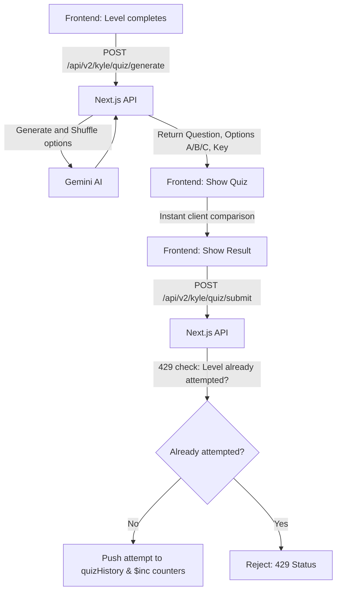
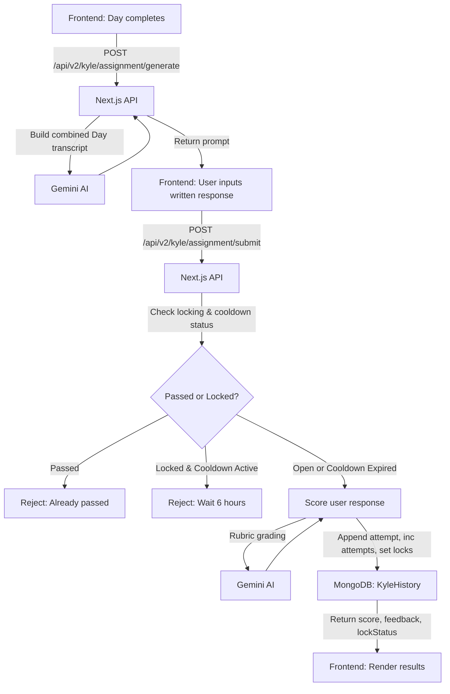

# Assignments & Mid-Video Quizzes Pipeline Documentation

This documentation covers the pipelines for generating and submitting mid-video quizzes (per-level) and written assignments (per-day) including scoring and cooldown rules.

---

## 1. Overview & Flowcharts

The system manages two learning progression pipelines:
1.  **Mid-Video Quiz**: Triggered at the end of each video level to test the level's concept. Grading is calculated client-side for immediate feedback, then recorded in MongoDB.
2.  **Written Assignment**: Triggered at the end of a full learning day. Users write answers evaluated by Gemini using a rubric. Attempts are capped at 3 per day, followed by a 6-hour lock cooldown.

### Mid-Video Quiz Pipeline



### Written Assignment Pipeline



---

## 2. Architecture & File Registry

*   **Next.js API Handlers**:
    *   `app/api/v2/kyle/quiz/generate/route.js` & `/submit/route.js`
    *   `app/api/v2/kyle/assignment/generate/route.js` & `/submit/route.js`
*   **Centralized LLM Service Layer**:
    *   `features/kyle/lib/kyle.service.js` (Prompt building, JSON parsing, and Gemini integration)
    *   `features/kyle/lib/gemini.client.js` (Gemini API client with key rotation logic)
    *   `features/kyle/lib/system.prompts.js` (System guidelines and grading rubrics)
*   **Mongoose Database Model**:
    *   `models/v2/kyle.history.model.js` (Mongoose collection schema for user learning attempts)

---

## 3. Schemas, API Endpoints, & Integration

### Mongoose Database Schema (`KyleHistory`)
Stores quiz and assignment history. Referenced in `UserProfile.kyleHistory`.
```js
const KyleHistorySchema = new Schema({
  firebaseUID: { type: String, required: true, unique: true, index: true },
  quizHistory: [{
    levelId: { type: String, required: true },
    dayNumber: { type: Number, required: true },
    concept: { type: String, required: true },
    question: { type: String, required: true },
    selectedOption: { type: String, required: true },
    wasCorrect: { type: Boolean, required: true },
    submittedAt: { type: Date, default: Date.now }
  }],
  totalQuizzesCorrect: { type: Number, default: 0 },
  totalQuizzesWrong: { type: Number, default: 0 },
  assignmentHistory: [{
    dayNumber: { type: Number, required: true },
    role: { type: String, required: true },
    assignmentPrompt: { type: String, required: true },
    attempts: [{
      userResponse: { type: String, required: true },
      score: { type: Number, required: true }, // 1-10
      feedback: { type: String, required: true },
      passed: { type: Boolean, required: true },
      submittedAt: { type: Date, default: Date.now }
    }],
    attemptCount: { type: Number, default: 0 },
    passed: { type: Boolean, default: false },
    locked: { type: Boolean, default: false },
    lockedUntil: { type: Date, default: null }
  }],
  assignmentsPassed: { type: Number, default: 0 }
});
```

---

## 4. API Endpoints

### Mid-Video Quiz Endpoints

#### 1. POST `/api/v2/kyle/quiz/generate`
Generates a quiz question with options A, B, and C (shuffled).
*   **Payload**:
    ```json
    {
      "concept": "Variables and Constant Declarations",
      "transcript": "In JS, we use let for reassignable values, and const for constants.",
      "role": "developer"
    }
    ```
*   **Response (200 OK)**:
    ```json
    {
      "data": {
        "question": "Which keyword prevents re-assignment?",
        "options": {
          "A": "var",
          "B": "let",
          "C": "const"
        },
        "correctAnswer": "C",
        "explanation": "const declares a read-only reference to a value."
      }
    }
    ```

#### 2. POST `/api/v2/kyle/quiz/submit`
Saves quiz result to MongoDB. Capped at one submission per `levelId`.
*   **Payload**:
    ```json
    {
      "levelId": "lvl_js_101",
      "dayNumber": 1,
      "concept": "Variables and Constant Declarations",
      "question": "Which keyword prevents re-assignment?",
      "selectedOption": "C",
      "wasCorrect": true
    }
    ```
*   **Response (200 OK)**:
    ```json
    { "data": { "recorded": true } }
    ```
*   **Error Response (429 Too Many Requests - Already Attempted)**:
    ```json
    { "error": "This quiz has already been answered" }
    ```

---

### Written Assignment Endpoints

#### 1. POST `/api/v2/kyle/assignment/generate`
Combines day level transcripts to produce a written case study assignment.
*   **Payload**:
    ```json
    {
      "role": "developer",
      "dayNumber": 1,
      "levels": [
        { "concept": "Let vs Const", "transcript": "Transcript of let/const..." },
        { "concept": "Arrow Functions", "transcript": "Transcript of arrow functions..." }
      ]
    }
    ```
*   **Response (200 OK)**:
    ```json
    {
      "data": {
        "assignmentPrompt": "Create a refactoring plan that changes old var statements to let/const..."
      }
    }
    ```

#### 2. POST `/api/v2/kyle/assignment/submit`
Scores the user's input. Validates cooldown status. Capped at 3 failures before locking for 6 hours.
*   **Payload**:
    ```json
    {
      "role": "developer",
      "dayNumber": 1,
      "levels": [
        { "concept": "Let vs Const", "transcript": "Transcript..." }
      ],
      "assignmentPrompt": "Create a refactoring plan...",
      "userResponse": "Here is my plan: I will use const for arrays and let for loop counters..."
    }
    ```
*   **Response (200 OK - Score results)**:
    ```json
    {
      "data": {
        "score": 8,
        "feedback": "Great application of const and let. You correctly identified re-assignment cases.",
        "passed": true,
        "attemptsRemaining": 0,
        "lockedUntil": null,
        "breakdown": {
          "topic_relevance": 9,
          "concept_application": 8,
          "prompt_quality": 8,
          "role_aptitude": 8
        },
        "weaknesses": ["Consider adding details about block scoping limitations."]
      }
    }
    ```
*   **Response (200 OK - Fail, Attempts remaining)**:
    ```json
    {
      "data": {
        "score": 4,
        "feedback": "You did not cover arrow functions properly. Please retry.",
        "passed": false,
        "attemptsRemaining": 2,
        "lockedUntil": null,
        "breakdown": { "topic_relevance": 5, "concept_application": 3, "prompt_quality": 4, "role_aptitude": 4 },
        "weaknesses": ["Arrow function explanation missing"]
      }
    }
    ```
*   **Error Response (423 Locked - Cooldown Active or Already Passed)**:
    ```json
    {
      "error": "Assignment locked — please wait before retrying",
      "lockedUntil": "2026-07-20T16:00:00.000Z"
    }
    ```

---

## 5. Frontend Integration Snippets

### A. Submitting Mid-Video Quiz
```javascript
const submitQuizResult = async (user, quizAttempt) => {
  const token = await user.getIdToken();
  const response = await axios.post("/api/v2/kyle/quiz/submit", quizAttempt, {
    headers: { Authorization: `Bearer ${token}` }
  });
  return response.data;
};
```

### B. Submitting Written Assignment (Handling Lock Statuses)
```javascript
const submitAssignment = async (user, payload) => {
  try {
    const token = await user.getIdToken();
    const response = await axios.post("/api/v2/kyle/assignment/submit", payload, {
      headers: { Authorization: `Bearer ${token}` }
    });
    
    const { score, feedback, passed, attemptsRemaining, lockedUntil } = response.data.data;
    
    if (passed) {
      alert("Congratulations! You passed.");
    } else if (attemptsRemaining === 0) {
      alert(`Out of attempts! Locked until: ${new Date(lockedUntil).toLocaleTimeString()}`);
    } else {
      alert(`Incorrect. You have ${attemptsRemaining} attempts left.`);
    }
    return response.data.data;
  } catch (error) {
    if (error.response?.status === 423) {
      const { lockedUntil } = error.response.data;
      alert(`Assignment is locked. Please try again after ${new Date(lockedUntil).toLocaleTimeString()}`);
    } else {
      alert("Submission failed. Please check your connection.");
    }
    throw error;
  }
};
```
