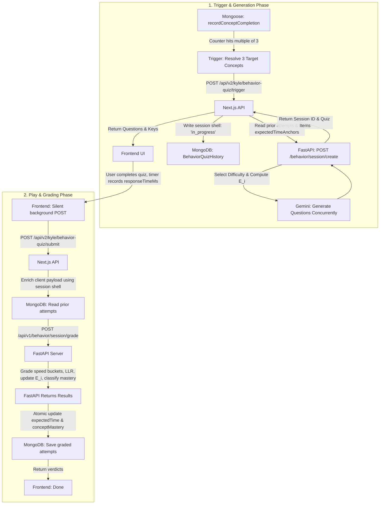

# Behavior Quiz Pipeline Documentation

This documentation covers the pipeline for triggering, generating, grading, and classifying user mastery of learning concepts using reaction time latency and Log-Likelihood Ratio (LLR) scoring.

---

## 1. Overview & Flowchart

The Behavior Quiz runs completely out-of-band from standard curriculum progression. It triggers every 3rd concept completion to statistically separate active knowledge from guessing.

### Pipeline Flowchart



---

## 2. Architecture & File Registry

*   **FastAPI Backend (grading math & question gen)**:
    *   `core/behavior_engine.py` (Math formulas for latency, speed buckets, confidence, LLR, shrinkage, and mastery verdicts)
    *   `features/kyle_behavior_quiz/generate/service.py` & `router.py` (difficulty selection, E_i cold start, concurrent Gemini calling)
    *   `features/kyle_behavior_quiz/submit/service.py` & `router.py` (grades attempts, updates E_i anchors, pools history, runs classifier)
    *   `schemas/behavior_quiz.py` (Pydantic validation schemas)
*   **Next.js Frontend / Gateway (state store & orchestration)**:
    *   `app/api/v2/kyle/behavior-quiz/trigger/route.js` (orchestrates generation)
    *   `app/api/v2/kyle/behavior-quiz/submit/route.js` (orchestrates grading & persistence)
    *   `models/v2/behavior.quiz.history.model.js` (atomic completion logger, session logs, expected times, concept mastery verdicts)

---

## 3. Core Engine Math & Logic

The behavior engine operates on the following mathematical rules:

### A. expectedTimeAnchors ($E_i$) Shrinkage
To prevent abnormal user speed metrics from skewing grading, the system uses an Empirical Bayes shrinkage formula ($w = 10$).
*   **Difficulty Anchors ($Anchor_i$)**: Easy = 12s, Medium = 20s, Hard = 32s.
*   **Incremental Update Formula**:
    $$E_{i,\text{new}} = \frac{E_{i,\text{current}} \times (10 + n) + t_{\text{observed}}}{10 + n + 1}$$

### B. Speed Bucketing & Confidence ($c_i$)
Reaction time ratio is calculated as $r_i = t_i / E_i$.
*   $t_i > 70$ seconds $\to$ `UNATTEMPTED`
*   $t_i \ge 60$ seconds $\to$ `GRACE` (confidence capped at 0.15)
*   $r_i \le 0.5$ $\to$ `FAST`
*   $r_i \le 1.3$ $\to$ `MEDIUM`
*   Otherwise $\to$ `SLOW`
*   **Confidence formula**:
    $$c_i = \frac{1}{1 + r_i^2}$$

### C. Log-Likelihood Ratio (LLR) & Mastery Classification
LLR is computed by assessing probabilities of knowing vs guessing:
$$LLR = \ln\left(\frac{P(\text{known})}{P(\text{guess})}\right)$$
*   **Red-Green-Blue (RGB) Flag**: Triggered if response time is disengaged: $t_i < \max(3000\text{ms}, 0.10 \times E_i)$. If $\ge \frac{2}{3}$ attempts are flagged, verdict $\to$ `DISENGAGED_GUESSING`.
*   **Mastery Verdict**: Posterior $\ge 0.75$ and binomial chance $p_{chance} < 0.05$ (meaning fast & correct answers are statistically unlikely to be guessed).
*   **Knowledge Gap Verdict**: Posterior $\le 0.25$ and majority ($\ge 50\%$) of wrong answers are Slow or Grace.

---

## 4. Schemas & API Endpoints

### MongoDB Schema (`BehaviorQuizHistory`)
```js
const BehaviorQuizHistorySchema = new Schema({
  firebaseUID: { type: String, required: true, unique: true, index: true },
  conceptsCompletedCounter: { type: Number, default: 0 },
  expectedTimeAnchors: { type: Map, of: Number, default: {} }, // Key: "concept::tier" -> E_i (ms)
  expectedTimeSampleCounts: { type: Map, of: Number, default: {} }, // Key: "concept::tier" -> n
  behaviorQuizSessions: [{
    sessionId: { type: String, index: true },
    triggeredAfterConceptCount: { type: Number },
    targetConcepts: [String],
    status: { type: String, enum: ["in_progress", "completed", "abandoned"], default: "in_progress" },
    generatedItems: [{
      concept: String,
      difficultyTier: String,
      question: String,
      options: [String],
      correctOption: String,
      nOptions: Number,
      eiSnapshot: Number,
      modelVersion: String
    }],
    attempts: [{
      concept: String,
      difficultyTier: String,
      question: String,
      selectedOption: String,
      wasCorrect: Boolean,
      nOptions: Number,
      responseTimeMs: Number,
      speedBucket: String,
      llrContribution: Number,
      rgbFlag: Boolean,
      modelVersion: String,
      submittedAt: { type: Date, default: Date.now }
    }]
  }],
  conceptMastery: { type: Map, of: new Schema({
    llr_total: Number,
    nAttempts: Number,
    verdict: String,
    posterior: Number,
    modelVersion: String,
    lastUpdatedAt: Date
  })}
});
```

### Endpoints (Client-Facing Next.js Gateway)

#### 1. POST `/api/v2/kyle/behavior-quiz/trigger`
Initializes a behavior quiz session and fetches questions.
*   **Payload**:
    ```json
    {
      "targetConcepts": ["closures", "scopes"],
      "conceptContexts": {
        "closures": { "transcriptContext": "...", "levelContext": "..." },
        "scopes": { "transcriptContext": "...", "levelContext": "..." }
      }
    }
    ```
*   **Response (200 OK)**:
    ```json
    {
      "sessionId": "4a7b0368-23bb-40cf-8a2b-cfd2a938c032",
      "quizItems": [
        {
          "concept": "closures",
          "difficultyTier": "medium",
          "question": "What is a closure?",
          "options": ["A function retaining access to outer scope", "An enclosed tag", "An IIFE closure"],
          "correctOption": "A function retaining access to outer scope",
          "nOptions": 3,
          "eiSnapshot": 20000,
          "modelVersion": "v1"
        }
      ]
    }
    ```

#### 2. POST `/api/v2/kyle/behavior-quiz/submit`
Silently grades user answers in the background.
*   **Payload**:
    ```json
    {
      "sessionId": "4a7b0368-23bb-40cf-8a2b-cfd2a938c032",
      "submittedAttempts": [
        {
          "concept": "closures",
          "selectedOption": "A function retaining access to outer scope",
          "responseTimeMs": 14200
        }
      ]
    }
    ```
*   **Response (200 OK)**:
    ```json
    {
      "conceptVerdicts": {
        "closures": {
          "verdict": "DEVELOPING",
          "nAttempts": 1,
          "posterior": 0.62,
          "llr_total": 0.49,
          "pChance": null,
          "rgbCount": 0
        }
      }
    }
    ```

---

## 5. Frontend Integration Snippets

### A. Step-by-Step State Play Controller
```javascript
const handleQuizPlay = (quizItems) => {
  let currentIndex = 0;
  let startTime = Date.now();
  const responses = [];

  const onAnswer = (selectedOption) => {
    const endTime = Date.now();
    const responseTimeMs = endTime - startTime;

    responses.push({
      concept: quizItems[currentIndex].concept,
      selectedOption,
      responseTimeMs
    });

    // Provide immediate visual feedback since correctOption is present in quizItems
    const isCorrect = selectedOption === quizItems[currentIndex].correctOption;
    showInstantUIFeedback(isCorrect);

    if (currentIndex < quizItems.length - 1) {
      currentIndex++;
      startTime = Date.now(); // reset timer
      renderNextQuestion();
    } else {
      submitSessionResults(responses);
    }
  };
};
```

### B. Background Submission Call
```javascript
const submitSessionResults = async (responses) => {
  const token = await user.getIdToken();
  
  // Submit in the background silently
  try {
    const response = await axios.post("/api/v2/kyle/behavior-quiz/submit", {
      sessionId: currentSessionId,
      submittedAttempts: responses
    }, {
      headers: { Authorization: `Bearer ${token}` }
    });
    
    // Response holds conceptVerdicts to optionally update UI/badges
    updateConceptVerdictsLocally(response.data.conceptVerdicts);
  } catch (error) {
    console.error("Failed to submit behavior quiz results:", error);
  }
};
```
