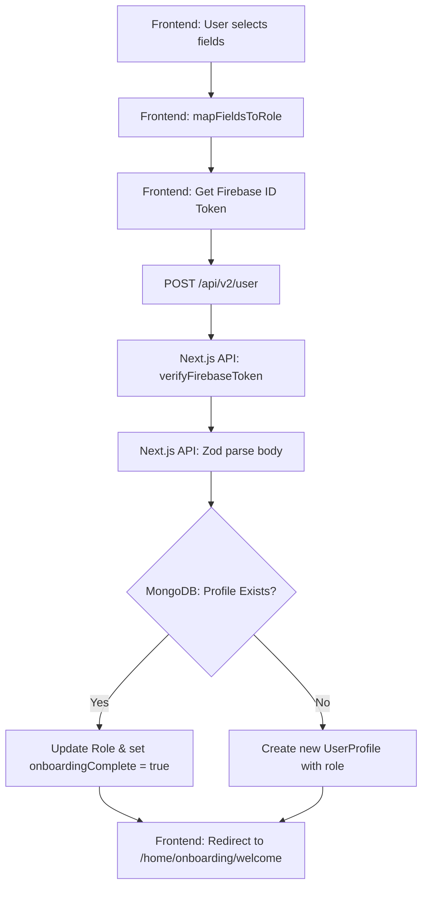

# Onboarding Flow Pipeline Documentation

This documentation details the step-by-step pipeline for user onboarding, mapping selected technical fields to application roles, and persisting user profiles in MongoDB.

---

## 1. Overview & Flowchart

During onboarding, a new user selects their fields of interest (e.g., UI/UX, backend, Gen AI). The frontend maps these interests to one of the system-recognized roles, fetches a Firebase ID Token, and calls the Next.js API. The backend verifies the token and securely records the onboarding status in MongoDB.

### Pipeline Flowchart



---

## 2. Architecture & File Registry

The onboarding flow spans the following files:

*   **Frontend UI & State**: `features/onboarding/OnboardingFlow.jsx` (Client-side interactive steps, field mapping, localStorage caching)
*   **Next.js API Route**: `app/api/v2/user/route.js` (Token verification, payload validation, MongoDB read/write)
*   **Mongoose Model**: `models/v2/user.profile.model.js` (Schema representation for user profiles)
*   **Firebase Utility**: `lib/firebase/firebase-admin.js` (Firebase admin SDK wrapper for server-side token validation)

---

## 3. Schemas, API Endpoints, & Integration

### Mongoose Database Schema (`UserProfile`)
Only relevant fields managed during onboarding:
```js
const UserProfileSchema = new Schema({
  firebaseUID: { type: String, required: true, unique: true, index: true },
  email: { type: String, required: true, unique: true, lowercase: true, trim: true },
  role: { 
    type: String, 
    enum: ["student", "writer", "designer", "developer", "other"], 
    default: "student" 
  },
  onboardingComplete: { type: Boolean, default: false, index: true },
  completedAt: { type: Date, default: null }
}, { timestamps: true });
```

### API Endpoints

#### 1. POST `/api/v2/user` (Submit Onboarding Data)
Saves the onboarding selections. Automatically updates an existing profile or creates a new one.

*   **Headers**:
    ```http
    Authorization: Bearer <FIREBASE_ID_TOKEN>
    Content-Type: application/json
    ```
*   **Request Payload**:
    ```json
    {
      "email": "learner@ignitio.com",
      "role": "developer"
    }
    ```
*   **Success Response (201 Created - New Profile)**:
    ```json
    {
      "message": "User profile created",
      "user": {
        "id": "60d0fe4f5311236168a109ca",
        "email": "learner@ignitio.com",
        "onboardingComplete": true,
        "createdAt": "2026-07-20T10:00:00.000Z"
      },
      "existing": false
    }
    ```
*   **Success Response (200 OK - Existing Profile Updated)**:
    ```json
    {
      "message": "User profile updated",
      "user": {
        "id": "60d0fe4f5311236168a109ca",
        "email": "learner@ignitio.com",
        "onboardingComplete": true,
        "createdAt": "2026-07-20T08:00:00.000Z"
      },
      "existing": true
    }
    ```
*   **Error Response (422 Unprocessable Entity - Validation Failed)**:
    ```json
    {
      "message": "Validation failed",
      "field": "role",
      "detail": "Invalid enum value"
    }
    ```

#### 2. GET `/api/v2/user` (Retrieve Profile & Check Onboarding Status)
Checks if the current authenticated user has already onboarded.

*   **Headers**:
    ```http
    Authorization: Bearer <FIREBASE_ID_TOKEN>
    ```
*   **Success Response (200 OK)**:
    ```json
    {
      "message": "User profile found",
      "user": {
        "_id": "60d0fe4f5311236168a109ca",
        "email": "learner@ignitio.com",
        "role": "developer",
        "onboardingComplete": true,
        "requiresOnboarding": false
      }
    }
    ```

---

## 4. Frontend Integration Snippets

### A. Role Mapping Utility
Map selected multi-fields from UI to the standardized database role:
```javascript
const mapFieldsToRole = (fields) => {
  const f = fields.join(" ").toLowerCase();
  if (f.includes("ui/ux")) return "designer";
  if (f.includes("development") || f.includes("cloud") || f.includes("cybersecurity")) return "developer";
  if (f.includes("gen ai") || f.includes("ai/ml")) return "developer";
  return "other";
};
```

### B. Client API Submission
Call this when the user clicks "Complete Onboarding":
```javascript
import axios from "axios";

const completeOnboarding = async (user, selectedFields) => {
  try {
    const idToken = await user.getIdToken();
    const role = mapFieldsToRole(selectedFields);
    
    const response = await axios.post("/api/v2/user", 
      { email: user.email, role },
      {
        headers: {
          "Content-Type": "application/json",
          "Authorization": `Bearer ${idToken}`
        }
      }
    );
    
    // Save locally and redirect
    localStorage.setItem("onboarding_completed", JSON.stringify(response.data.user));
    return response.data;
  } catch (error) {
    console.error("Onboarding failed:", error.response?.data?.message || error.message);
    throw error;
  }
};
```
